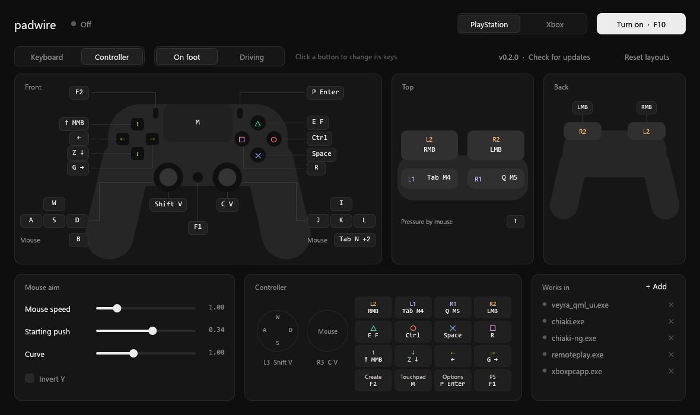

# padwire

Keyboard and mouse as a virtual PlayStation or Xbox controller, for playing a console over Remote Play on Windows. Ships with GTA 6 layouts.


## Setup

1. Install the [ViGEmBus](https://github.com/nefarius/ViGEmBus/releases/latest) driver.
2. Download `padwire.exe` from [Releases](https://github.com/canmenzo/padwire/releases/latest) and run it. Or build it: `cargo build --release`.
3. Connect to the console in your Remote Play app. Veyra, chiaki-ng, PS Remote Play and the Xbox app are listed already; add any other under **Works in**. A capture card carries only the picture: the pad reaches the console through Remote Play (in Veyra's capture view, turn on **Control the PS5 through Remote Play**).
4. Press **F10** in the game window.

## Controls

| | |
|---|---|
| F10 | On / off |
| Alt+Tab | Leave. Keyboard, mouse and cursor are yours again |
| F | Get in or out, and switch between the on-foot and driving layouts |
| Caps Lock | Switch layout by hand |

The layouts follow GTA V on PC: WASD, Space to jump, Shift to run, Ctrl to crouch, Q for cover, Tab for the loadout wheel, C to look back, W / S for gas and brake in a car.

padwire acts only while it is on and one of the listed apps is in front. While off it installs no hooks.

## Sticks and triggers by mouse

The mouse normally turns the camera, so the right stick springs back when the mouse stops. Some things in GTA 6 need a stick held at an angle, or a trigger held part way. For those, hold one of these keys and move the mouse:

| | | |
|---|---|---|
| N | The mouse points the right stick and it stays put | Slim Jim, key cloner, hotwire (right half) |
| B | The same for the left stick | Hotwire (left half), snap gun, valves |
| T | Mouse sideways presses L2, mouse up presses R2, as far as you move | Safe drill, weights |
| Tab, Q in a car | Open the wheel, flick the mouse at a slot, let go | Loadout, radio and vehicle menu |
| I J K L | Right stick up, left, down, right | Quick stick pushes without the mouse |

Hotwire: hold B and flick the mouse where the L arrow points, keep B down, hold N and flick where the R arrow points. Draw circles with the mouse while holding N to reel a fish.

## GTA 6 settings

From the game's menus as guides list them; not every value was tried.

| Where | Setting | Value |
|---|---|---|
| Controller | Look and Aim Acceleration | 0 |
| Controller | Look and Aim Sensitivity | 14 |
| Controller | Aim Response Curve | Linear |
| Gameplay | Movement Speed | Jog |
| Gameplay | Targeting | Free Aim, Shooting Assist off |
| Accessibility | Simplified Mini Games | On |
| Accessibility | Tap Assist | Hold |
| Accessibility | Fishing | Hold |

## Rebinding

**Keyboard** tab: click a key, pick one or more buttons. **Press once to hold** turns the key into a toggle (aim, gas).


**Controller** tab: the pad from the front, top and back, with the keys on each button. Click a button, then press the key or mouse button you want on it. A button takes two keys at most.

**Reset layouts** brings back the built-in layouts; a layout you saved with an older version stays until you do.



Settings are saved to `%APPDATA%\padwire\config.json`.

padwire asks GitHub for the newest release when it starts and shows a **Get** button if there is one. It opens the download page; it never replaces itself.

## Tests

```
cargo test
target\release\padwire.exe --selftest | more
```

`cargo test` covers the mapping, the aim maths and the UI. `--selftest` needs the driver: it plugs in the virtual pad, sends injected keys and mouse through the real hooks, and reads the pad back from Windows.

## Credits

A Rust rewrite that merges two MIT projects:

- [rewire](https://github.com/prettierweb/rewire): the two GTA layouts, the mouse aim, the eased steering, acting only in the game window.
- [re-B.U.N.S](https://github.com/FaZeBuns/re-B.U.N.S): toggle bindings, the PlayStation / Xbox switch, the live controller view.

Built for single player. Not affiliated with Sony, Microsoft or Rockstar.
