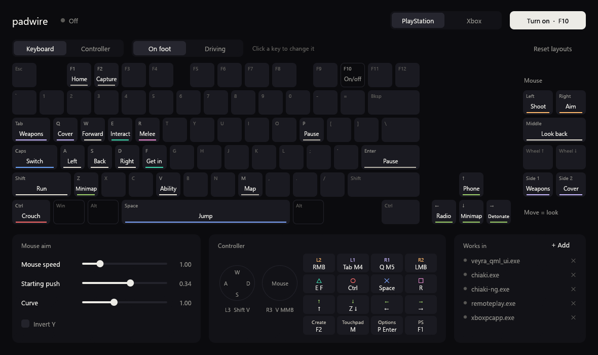
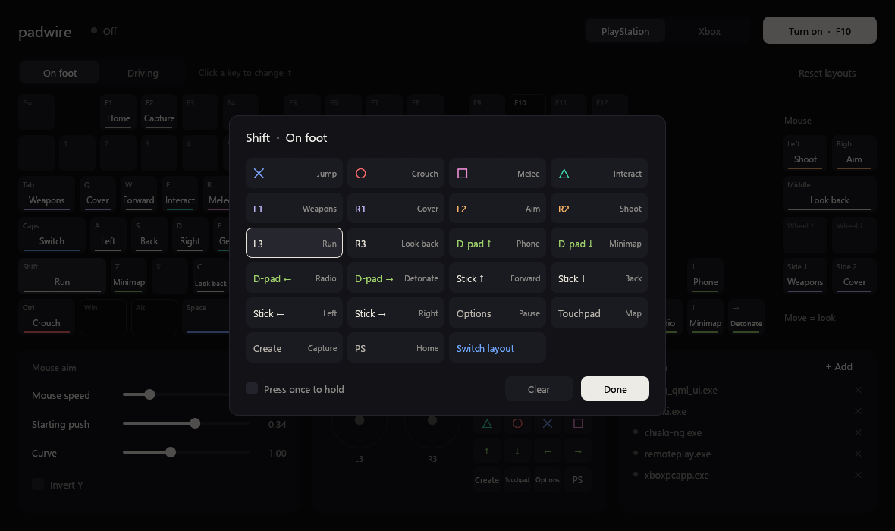

# padwire

Keyboard and mouse as a virtual PlayStation or Xbox controller, for playing a console over Remote Play on Windows. Ships with GTA 6 layouts.



## Setup

1. Install the [ViGEmBus](https://github.com/nefarius/ViGEmBus/releases/latest) driver.
2. Download `padwire.exe` from [Releases](https://github.com/canmenzo/padwire/releases/latest) and run it. Or build it: `cargo build --release`.
3. Open your Remote Play app. Veyra, chiaki-ng, PS Remote Play and the Xbox app are listed already; add any other under **Works in**.
4. Press **F10** in the game window.

In GTA 6 set look and aim acceleration to 0, sensitivity to max, aim assist off.

## Controls

| | |
|---|---|
| F10 | On / off |
| Alt+Tab | Leave. Keyboard, mouse and cursor are yours again |
| F | Get in or out, and switch between the on-foot and driving layouts |
| Caps Lock | Switch layout by hand |

padwire acts only while it is on and one of the listed apps is in front. While off it installs no hooks.

## Rebinding

Click a key, pick one or more buttons. **Press once to hold** turns the key into a toggle (aim, gas).



Settings are saved to `%APPDATA%\padwire\config.json`.

## Tests

```
cargo test
target\release\padwire.exe --selftest | more
```

`cargo test` covers the mapping, the aim maths and the UI. `--selftest` needs the driver: it plugs in the virtual pad, sends injected keys and mouse through the real hooks, and reads the pad back from Windows.

## Credits

A Rust rewrite that merges two MIT projects:

- [rewire](https://github.com/prettierweb/rewire): the two GTA layouts, the mouse aim, the eased steering, acting only in the game window.
- [re-B.U.N.S](https://github.com/FaZeBuns/re-B.U.N.S): toggle bindings, the PlayStation / Xbox switch, the live controller view.

Built for single player. Not affiliated with Sony, Microsoft or Rockstar.
